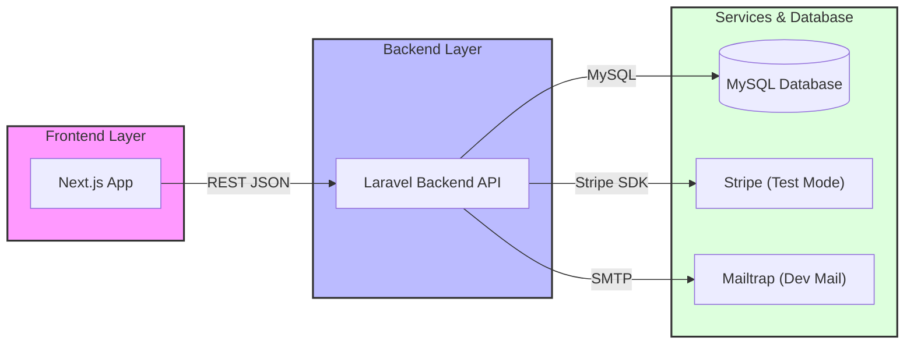

# Frontend (Next.js) Overview & System Architecture

## Project Overview
The **frontend** is a Next.js 14+ application (App Router) that provides the customer‑facing storefront and a separate admin panel. It consumes the Laravel backend API exclusively via RESTful JSON endpoints. All UI components are built with **shadcn/ui**, ensuring a consistent, accessible design system.

## Technology Stack
| Layer | Technology |
|-------|------------|
| **Framework** | Next.js 14+ (React, TypeScript) |
| **UI Library** | shadcn/ui (Tailwind‑CSS based) |
| **Styling** | Tailwind CSS |
| **State Management** | React Query / SWR (for data fetching) |
| **Testing** | Playwright / Jest (optional) |
| **API Calls** | Axios / fetch (wrapped in a service layer) |

## System Architecture

**Explanation**:
- The Next.js app renders pages for shoppers and admin users, fetching data from the backend via `/api/v1/...` endpoints.
- All business‑critical logic (authentication, RBAC, order processing, payments) resides in the backend; the frontend only displays data and sends user actions.
- UI components are sourced from the **shadcn/ui** library, built on top of Tailwind CSS.

## Folder Structure (frontend)
```
frontend/
├─ app/                # App Router pages (storefront & admin)
├─ components/         # UI components (generated by shadcn/ui)
│   └─ ui/            # shadcn/ui component library
├─ lib/                # API client, auth helpers, query hooks
├─ styles/             # Tailwind configuration & global CSS
├─ public/             # Static assets (images, favicon)
├─ .env.local          # Environment variables (e.g., VITE_API_BASE_URL)
└─ package.json        # Scripts, dependencies
```

## Installation Guide

1. **Clone the repository**
   ```bash
   git clone <repository-url>
   cd frontend
   ```
2. **Install dependencies**
   ```bash
   npm install
   ```
3. **Copy environment configuration**
   ```bash
   cp .env.example .env
   ```
4. **Configure API base URL** in `.env.local` (e.g., `NEXT_PUBLIC_API_BASE_URL=http://localhost:8000/api/v1`).
5. **Start the development server**
   ```bash
   npm run dev
   ```

After these steps the frontend will be reachable at `http://localhost:3000`.
1. `cd frontend && npm install` (or `yarn install`).
2. Copy `.env.example` to `.env.local` and set:
   ```
   NEXT_PUBLIC_API_BASE_URL=http://localhost:8000/api/v1
   ```
3. Run the dev server: `npm run dev` (default http://localhost:3000).
4. To add a new UI component, use the shadcn CLI:
   ```bash
   npx shadcn@latest add <component-name>
   ```
   The component will appear under `components/ui/`.
5. Import components as demonstrated:
   ```tsx
   import { Button } from "@/components/ui/button";
   ```

## UI Library – shadcn/ui
shadcn/ui provides a set of accessible, themeable Tailwind‑CSS components (buttons, dialogs, forms, tables, etc.). It integrates seamlessly with Next.js and supports dark mode out of the box. Use the CLI to generate or customize components, and follow the official docs for best practices.

---

## Testing (optional)
You can write end‑to‑end tests with **Playwright** or unit/component tests with **Jest**/React Testing Library. Configure scripts in `package.json`:
```json
"scripts": {
  "test": "jest",
  "test:e2e": "playwright test"
}
```

---

## License
MIT – see LICENSE file.
